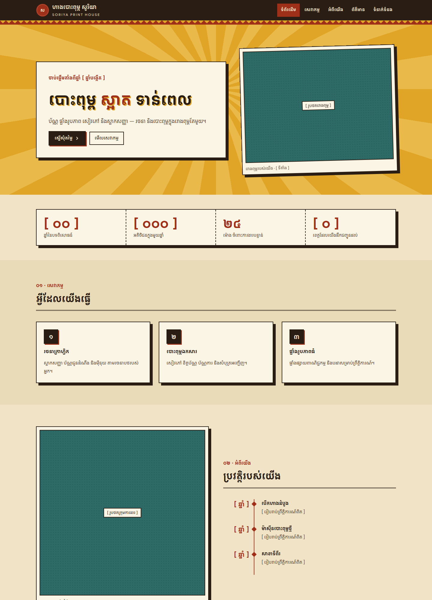
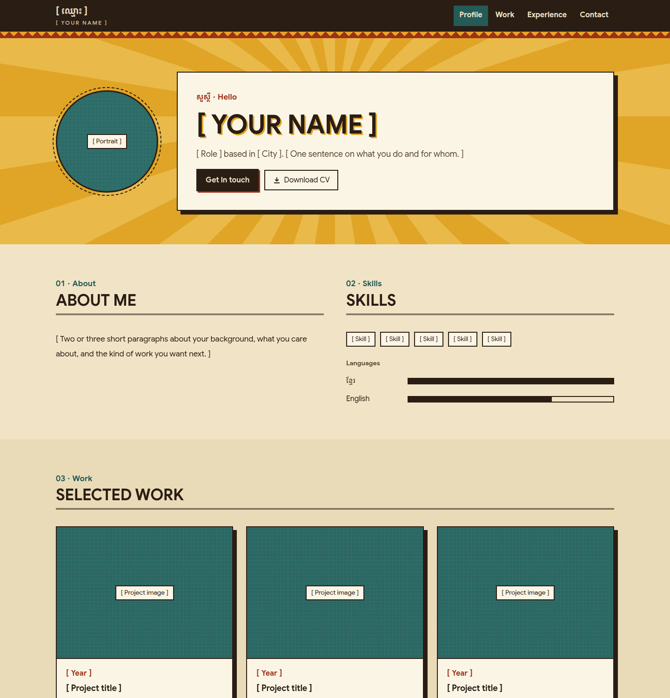

# Agent Skills

A collection of agent skills that work in Claude Code, Claude.ai and any agent that supports the
[Agent Skills](https://agentskills.io) format. Each skill lives in its own folder under `skills/` and can be
installed on its own.

## Skills

| Skill | What it does |
|---|---|
| [`retrokh-design`](#retrokh-design) | Designs and builds websites and apps in a Khmer old-school, 1970s print style |

More skills will be added here over time.

## Install

Install every skill in this repo:
```bash
npx skills add <your-github-user>/skills
```

Install one skill only:
```bash
npx skills add <your-github-user>/skills --skill retrokh-design
```

To see what's available without installing anything:
```bash
npx skills add <your-github-user>/skills --list
```

Manual install for Claude Code:
```bash
git clone https://github.com/<your-github-user>/skills
cp -r skills/skills/<skill-name> ~/.claude/skills/
```

For Claude.ai, zip one skill's folder (for example `skills/retrokh-design`) and upload it under
**Settings → Capabilities → Skills**.

## Repository layout

```
skills/
└── <skill-name>/          # one folder per skill (this is what gets installed)
    ├── SKILL.md           # required: frontmatter (name, description) + instructions
    ├── references/        # optional: docs the agent reads on demand
    ├── scripts/           # optional: code the agent runs (output only enters context)
    └── assets/            # optional: files the agent copies into projects (cp costs no tokens)
evals/
└── <skill-name>/          # test scenarios + how to run them (not installed)
docs/
└── <skill-name>/          # screenshots for this README (not installed)
```

---

## retrokh-design

Designs and builds **websites and apps** in **RetroKh**, a Khmer old-school, 1970s print style. It looks like cream
paper and dark-brown ink with red, turmeric and teal spot colours, a single typeface (Google Sans, Khmer + Latin) set
big and bold, square corners, hard offset shadows, zigzag, halftone and sunburst patterns, and rubber-stamp labels.

Use it for personal profiles and CVs, company profiles, organisation, NGO and school sites, restaurants and shops,
events, blogs, landing pages, dashboards and app screens. It produces HTML/CSS, Tailwind (v3 and v4) or Vue 3, and
writes Khmer-first copy with English or bilingual support.



<details><summary>Personal profile (English-primary)</summary>


</details>

### Use

Ask for anything in the style, for example:
- "Build my personal profile website in Khmer retro style"
- "Make a company profile site for my print shop, RetroKh style, Khmer and English"
- "Create an NGO website that looks like a 1970s Cambodian poster"
- "Build a Khmer retro login page in Vue + Tailwind"
- "Make this dashboard look like an old-school Khmer print, keep it bilingual"
- "Design a restaurant menu page / wedding invitation site, RetroKh style"

The skill triggers on phrases such as *Khmer retro*, *old school Khmer*, *Cambodian vintage*, *60s/70s Khmer*,
*golden era* and *RetroKh*, or you can call it directly with `/retrokh-design`.

### What's inside

```
skills/retrokh-design/
├── SKILL.md                    # era, 7 rules, workflow (inspect → defaults → copy → read on demand → verify), tokens
├── references/                 # each read only when the task needs it
│   ├── classes.md              # every retrokh.css class in one line + skeletons, icons, states
│   ├── websites.md             # site plan, rhythm, recipes per site type, images, page must-haves
│   ├── style.md                # colour + contrast, dark mode, shape, type, Khmer text, bilingual, voice, ornament
│   └── stacks.md               # Tailwind v4/v3, Vue 3 SFCs, shadcn, Bootstrap 5/4 adapters
├── scripts/
│   └── check_retrokh.py        # linter for the run → fix → re-run loop (fonts, corners, shadows, lang…)
└── assets/                     # copied into projects with cp, never read into context
    ├── retrokh.css             # tokens, patterns, app + website components (light + dark)
    ├── tailwind.preset.js      # Tailwind v3
    ├── tailwind.v4.css         # Tailwind v4
    └── templates/
        ├── company-profile.html    # Khmer company site: copy next to retrokh.css, then edit
        └── personal-profile.html   # English-primary profile / CV
```

### Palette

| paper | sheet | ink | red | turmeric | teal |
|---|---|---|---|---|---|
| `#F1E4C6` | `#FBF5E6` | `#2A1D14` | `#9E2F18` | `#E0A526` | `#245A57` |

Every text pair meets WCAG AA (ink on paper 12.9:1, red on paper 5.8:1, teal on paper 6.2:1).

### Evals

Three scenarios (a Khmer company site, an English portfolio and a Vue + Tailwind component) are in
[`evals/retrokh-design/`](evals/retrokh-design/), with run and grading instructions.

### Credits

Distilled from the *Dobpi* 1970s Khmer Retro design canvas. The only typeface is Google Sans (Khmer + Latin),
from Google Fonts under the SIL Open Font License.

---

## Adding a new skill

1. Create `skills/<skill-name>/SKILL.md`. The folder name must match the `name:` in its frontmatter (lowercase,
   hyphens). Write a `description:` that says what the skill does **and** when it should trigger (max 1024 characters).
2. Keep `SKILL.md` short (the guide's limit is 500 lines; aim for far less) and put details in `references/`, one level deep,
   each read only when needed. Put files the agent copies into projects in `assets/`, and tell it to `cp` them, not Read them.
3. Put README screenshots in `docs/<skill-name>/`, not inside the skill folder, so they aren't installed.
4. Add at least three scenarios to `evals/<skill-name>/evals.json` and run them with Haiku, Sonnet and Opus
   (see `evals/retrokh-design/README.md` for the format and the run commands).
5. Add a row to the [Skills](#skills) table and a `## <skill-name>` section below it.
6. Validate and check the repo still lists every skill:
   ```bash
   uvx --from skills-ref agentskills validate skills/<skill-name>
   npx skills add . --list
   ```

## License

MIT
