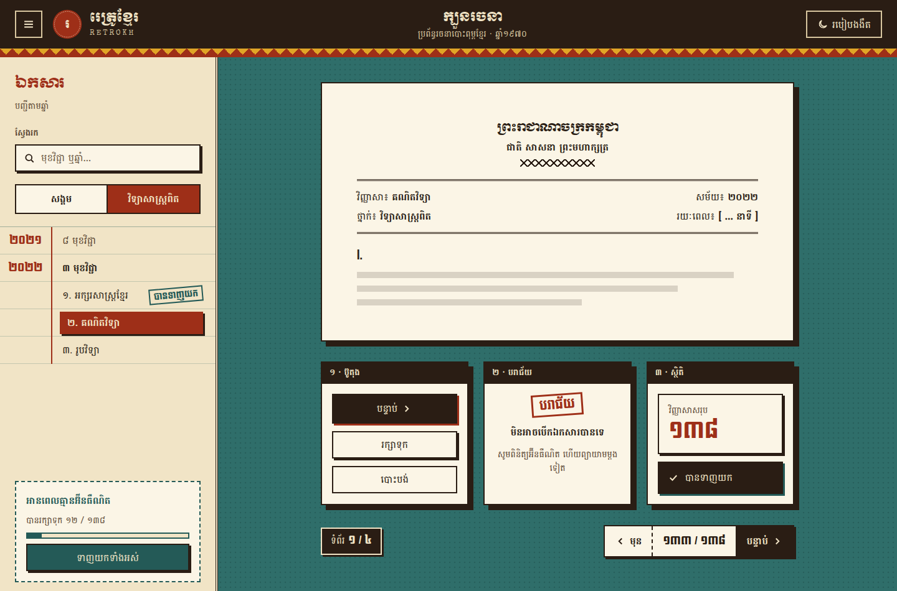
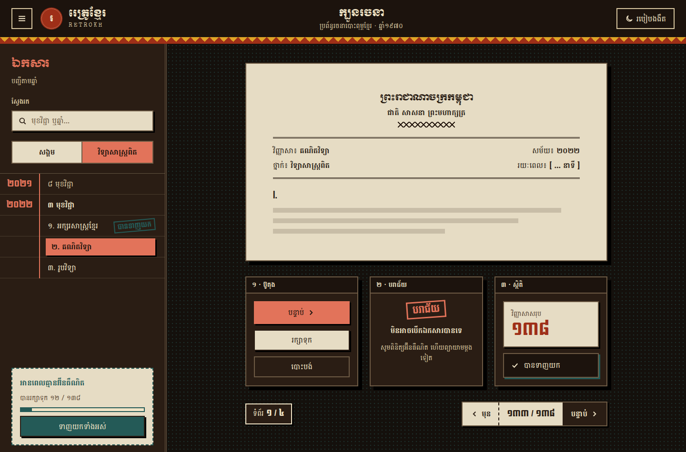

# retrokh-design

An agent skill that designs and builds UI in **RetroKh**, a Khmer old-school, 1970s print style. It looks like
cream paper and dark-brown ink with red, turmeric and teal spot colours. It uses Moul and Koulen display type, square
corners, hard offset shadows, zigzag, halftone and sunburst patterns, and rubber-stamp labels.



<details><summary>Dark mode (night print)</summary>


</details>

It works in Claude Code, Claude.ai and any agent that supports the [Agent Skills](https://agentskills.io) format.

## Install

```bash
npx skills add <your-github-user>/retrokh-design
```

Manual install for Claude Code:
```bash
git clone https://github.com/<your-github-user>/retrokh-design
cp -r retrokh-design/skills/retrokh-design ~/.claude/skills/
```
For Claude.ai, zip the `skills/retrokh-design` folder and upload it under **Settings → Capabilities → Skills**.

## Use

Ask for anything in the style, for example:
- "Build a Khmer retro login page in Vue + Tailwind"
- "Make this dashboard look like an old-school Khmer print, keep it bilingual"
- "Design a ticket / poster / landing page, RetroKh style"

The skill triggers on phrases such as *Khmer retro*, *old school Khmer*, *Cambodian vintage*, *60s/70s Khmer*,
*golden era* and *RetroKh*, or you can call it directly with `/retrokh-design`.

## What's inside

```
skills/retrokh-design/
├── SKILL.md                    # laws, workflow, token table, signature moves, checklist
├── references/
│   ├── tokens.md               # palette + roles + contrast, dark mode, shape, space, token JSON
│   ├── typography.md           # Moul / Koulen / Battambang / Special Elite, Khmer script rules, numerals, voice
│   ├── patterns.md             # zigzag, halftone, rays, ruled, diamonds, seal, stamps, official header
│   ├── components.md           # buttons, inputs, tabs, header, ledger nav, drawer, cards, tables, states
│   ├── layouts.md              # app shell, phone, splash, dashboard, form, landing, style tile
│   ├── tailwind.md             # v3 preset + v4 @theme recipes
│   └── vue-react.md            # component set, React + Vue examples, khmer digit helper
├── assets/
│   ├── retrokh.css             # drop-in tokens, patterns, components (light + dark)
│   ├── tailwind.preset.js      # Tailwind v3
│   └── tailwind.v4.css         # Tailwind v4
└── examples/
    └── showcase.html           # working reference page (open in a browser; toggle dark mode)
```

## Palette

| paper | sheet | ink | red | turmeric | teal |
|---|---|---|---|---|---|
| `#F1E4C6` | `#FBF5E6` | `#2A1D14` | `#9E2F18` | `#E0A526` | `#245A57` |

Every text pair meets WCAG AA (ink on paper 12.9:1, red on paper 5.8:1, teal on paper 6.2:1).

## Credits

Distilled from the *Dobpi* 1970s Khmer Retro design canvas. The fonts (Moul, Koulen, Battambang and Special Elite)
are from Google Fonts under the SIL Open Font License.

## License

MIT
